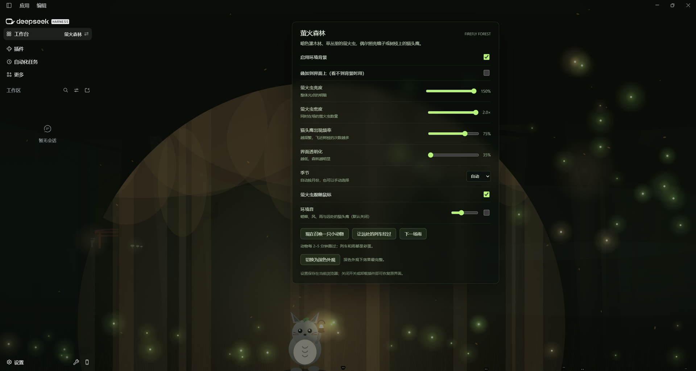

# dsh-firefly-forest



萤火森林：给 DeepSeek Harness（dsh）的界面后面垫一层夏夜的灌木林 —— 草叶上的萤火虫呼吸明灭，飞过的光点偶尔照亮树枝上的猫头鹰，或者叶子上的蛾子。

An ambient firefly forest behind the DSH Web UI: a dark shrub layer, breathing fireflies on grass blades, and an owl or a moth that lights up when a drifting spark passes by.

## 装 / Install

在 DSH Desktop 的 **设置 → 插件** 里搜索「萤火森林」安装（收录进市场之后），或者用命令行从本地包安装：

```sh
# 从本仓库 Release 里的预构建包安装
dsh plugin --profile web add ./dsh-firefly-forest-0.2.2.tgz
```

装好后刷新一次窗口（Desktop 端需要重启 Harness）。

## 效果 / What it does

- 暗色灌木林与草叶剪影，薄雾与极弱的月光，随主题在白天/夜晚之间切换色温
- 草叶尖上呼吸明灭的萤火虫，以及缓慢飞舞、偶尔闪亮的光点
- 偶尔一只萤火虫飞近树枝，先点出两点眼睛反光，再照亮猫头鹰的轮廓
- 叶子上的蛾子也会被路过的光点带出来
- 全窗口 canvas，垫在界面后面，不拦截鼠标；约 30fps，页面隐藏时暂停，尊重「减少动态效果」
- 在带工作台的客户端（如 DSH Desktop）里多一个「萤火森林」面板
- 关闭开关或卸载插件即恢复原界面；设置存在浏览器 localStorage，不联网

## 面板 / Panel

面板里有：总开关、萤火虫亮度、萤火虫密度、猫头鹰出现频率、界面透明化、叠加模式、季节、萤火虫跟随鼠标，以及环境音与音量。

## 兼容性 / Compatibility

- 需要带 `theme` 服务的 dsh Web 宿主（官方 dsh web 与基于它的桌面客户端均可）
- 「萤火森林」工作台面板只出现在提供 `desktopWorkbenches` 的客户端（DSH Desktop）；没有该服务的客户端上插件退化为纯背景，不影响加载

## 开发 / Development

- 客户端入口：`lib/client.js`（单文件，`window.__ModuleLoader__.load`）
- 服务端入口：`dsh/index.js`（空插件，只为把 bundle 挂进插件树）
- 预览：直接用浏览器打开 `preview/index.html`
- 打包：`pnpm pack`，产物用 DSH Desktop 的本地安装流程装进 profile

## 许可 / License

MIT
